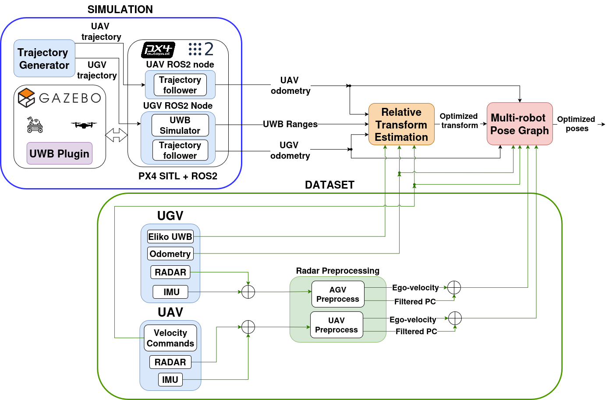

<h1 align="center"><a href="https://arxiv.org/abs/2509.26558" style="text-decoration:none;color:inherit;">Radio-based Multi-Robot Odometry and Relative Localization</a></h1>

<div align="center">
  <a href="https://www.youtube.com/watch?v=zTdIhjTZPeA"></a>
  <a href="https://arxiv.org/abs/2509.26558"></a>
  </a>
</div>

❗ **This work has been accepted to ICRA 2026!**

### Abstract
Radio-based methods such as Ultra-Wideband (UWB) and RAdio Detection And Ranging (RADAR), which have traditionally seen limited adoption in robotics, are experiencing a boost in popularity thanks to their robustness to harsh environmental conditions and cluttered environments. This work proposes a multi-robot UGV-UAV localization system that leverages the two technologies with inexpensive and readily-available sensors (Inertial Measurement Units, or IMUs, and wheel encoders) to estimate the relative position of an aerial robot with respect to a ground robot. The first stage of the system pipeline includes a nonlinear optimization framework to trilaterate the location of the aerial platform based on UWB range data, and a RADAR pre-processing module with loosely coupled ego-motion estimation which has been adapted for a multi-robot scenario. Then, the pre-processed RADAR data as well as the relative transformation are fed to a pose-graph optimization framework with odometry and inter-robot constraints. The system, implemented for the Robotic Operating System (ROS 2) with the Ceres optimizer, has been validated in Software-in-the-Loop (SITL) simulations and in a real-world dataset. The relative localization module outperforms state-of-the-art closed-form methods which are less robust to noise. Our SITL environment includes a custom Gazebo plugin for generating realistic UWB measurements modeled after real data.  Conveniently, the proposed factor graph formulation makes the system readily extensible to full Simultaneous Localization And Mapping (SLAM).  Finally, all the code and experimental data have been made publicly available to support reproducibility and to serve as a common open dataset for benchmarking.

## Basic Dependencies

* Ubuntu 22.04 LTS and ROS 2 [Humble](https://docs.ros.org/en/humble/index.html) or Ubuntu 24.04 LTS and ROS 2 [Jazzy](https://docs.ros.org/en/jazzy/index.html)
* [Ceres Solver](https://github.com/ceres-solver/ceres-solver)
* [Sophus](https://github.com/strasdat/Sophus)
* [small_gicp](https://github.com/koide3/small_gicp)
* [pcl_ros](https://github.com/ros-perception/perception_pcl)
* [eliko_ros](https://github.com/robotics-upo/eliko_ros)
* [ars548_ros](https://github.com/robotics-upo/ars548_ros)
* [4D-Radar-Odom](https://github.com/robotics-upo/4D-Radar-Odom/tree/arco-drone-integration) branch ```arco_drone_integration```.

Please follow the links above to the mentioned packages for specific setup instructions for each of them. 

## Main components

This repository contains one ROS 2 package:

* ```uwb_localization```: includes the UWB-based relative transformation estimation node and the pose-graph optimization node with radar constraints. The ```config``` folder in this package contains the parameter file for these two nodes, in the simulation variant without radar (``params_sim.yaml``) and the dataset variant with radar (``params_dataset.yaml``), using our setup-specific configuration.

The PX4/Gazebo SITL simulator lives in its own repository, [UWBPX4Sim](https://github.com/amartinezsilva/UWBPX4Sim). It includes the UWB plugin, modified UAV and UGV models for PX4 SITL, the ROS 2 bridge/offboard package, and the simulator launcher. It is **not** a submodule of this repository: you only need it if you want to run the SITL simulation, not to build this repository or to run the localization on recorded bags (including the real-world dataset). The two communicate only through ROS 2 topics (see [Launch files](#launch-files)). Detailed setup, plugin parameters, and usage instructions are documented in [the ```UWBPX4Sim``` README](https://github.com/amartinezsilva/UWBPX4Sim/blob/main/README.md).



Both setups described below put the repositories side by side in the same ROS 2 workspace:

```
<ros_ws>/src/
├── mr-radio-localization/   # this repository
├── UWBPX4Sim/               # only needed for the SITL simulation
└── ...                      # the other dependencies (local setup only)
```

## Running with Docker (Recommended)

A `docker/` folder provides ready-to-use images (Ubuntu 24.04, ROS 2 Jazzy) as an alternative to setting everything up natively. It requires [Docker](https://docs.docker.com/engine/install/) and the [Docker Compose plugin](https://docs.docker.com/compose/install/). There are two variants:

| Variant | Command | What's inside | Use it for |
|---|---|---|---|
| **Standalone** (default) | `./setup.sh` | The localization stack only (`FROM osrf/ros:jazzy-desktop`). No simulator. A few minutes to build. | Running the localization on your own rosbags or on the real-world dataset. |
| **SITL** | `./setup.sh --sim` | PX4 SITL, Gazebo Harmonic and the UWB plugin, plus the localization stack. Built `FROM` the [UWBPX4Sim](https://github.com/amartinezsilva/UWBPX4Sim) image. 30-45+ minutes the first time. | Running the full simulation and localizing in it. |

Both images install the localization dependencies with the same script (`docker/install_localization_deps.sh`), so they always have the same localization stack. Both bind-mount `uwb_localization/bags/` and `uwb_localization/config/` from the host: drop your recorded rosbags into `bags/` and tune `params_sim.yaml`/`params_dataset.yaml` in `config/`, and they're picked up the next time you launch, without rebuilding the image.

### Standalone image

```bash
git clone https://github.com/amartinezsilva/mr-radio-localization.git
cd mr-radio-localization/docker
./setup.sh
```

No UWBPX4Sim needed. `setup.sh` builds the image, starts a **persistent** container in the background and drops you into its guided menu:

1. **Launch localization**: pick `localization.launch.py` or `localization_dataset.launch.py`, then a bag from `uwb_localization/bags/`. It runs in the foreground with RViz; press Ctrl-C to stop it and return to the menu.
2. **Open a shell**: a plain shell in the container, with the workspace already sourced.
3. **Exit**: stops the container, and asks whether to remove it completely instead (see [Container lifecycle](#container-lifecycle)).

### SITL image

```bash
cd <ros_ws>/src
git clone https://github.com/amartinezsilva/mr-radio-localization.git
git clone https://github.com/amartinezsilva/UWBPX4Sim.git   # optional: setup.sh --sim offers to clone it if missing
cd mr-radio-localization/docker
./setup.sh --sim
```

This image is layered: it's built `FROM` the UWBPX4Sim simulator image (PX4 SITL, Gazebo, the UWB plugin -- see [its own README](https://github.com/amartinezsilva/UWBPX4Sim/blob/main/README.md#getting-started)), adding only this repo's radar/localization dependencies and ROS 2 package on top. You don't need to build that base image yourself first -- `./setup.sh --sim` builds it automatically (asking first) if it isn't already present locally.

`setup.sh --sim` looks for UWBPX4Sim next to this repository (`<ros_ws>/src/UWBPX4Sim`) and offers to clone it there if it's missing. To use a checkout somewhere else, point it there with `UWBPX4SIM_DIR=/path/to/UWBPX4Sim ./setup.sh --sim`. That checkout is used to build the base image and is bind-mounted into the container, so the simulator version you have checked out on the host is the one the container runs: layouts, plugin presets, worlds and trajectories edited on the host are picked up the next time you run setup (option 1). Under WSL2, `setup.sh` also adds `docker-compose.wsl.yml` automatically, so Gazebo renders on the GPU.

The first build compiles the UWBPX4Sim base image plus this repo's own workspace, so it can take a while (30-45+ minutes depending on your machine, mostly the one-time base image); subsequent runs reuse the cached images and start instantly, and rebuilding after a change to this repo's own code doesn't touch the PX4/Gazebo layers at all. The guided menu offers:

1. **Run UWBPX4Sim setup** (`setup_simulator.sh`): configure the PX4/Gazebo plugin, models, and layout inside the container. Opens a browser-based GUI (prints the URL, default `http://localhost:5050`) to build the robot layout and tune plugin parameters; falls back to terminal prompts if the GUI isn't available. Run this once, and again whenever you change the layout or plugin parameters.
2. **Launch simulation** (ticks once setup has been run): launches PX4 SITL, Gazebo, and the UWB bridge/offboard nodes via `simulator_launcher.sh`.
3. **Launch localization**: runs `ros2 launch uwb_localization localization.launch.py` in a new tmux window alongside the running simulation, to see the relative localization estimate. Needs the simulation (option 2) already running.
4. **Open a shell**: skip the menu and get a plain shell in the container.
5. **Exit**: stops the container, and asks whether to remove it completely instead (see [Container lifecycle](#container-lifecycle)).

### Container lifecycle

Both variants work the same way. The images and containers are named per variant (`mr-radio-localization:jazzy-standalone` / `mr-radio-localization-standalone`, and `mr-radio-localization:jazzy-sim` / `mr-radio-localization-sim`), so both can exist side by side.

The container keeps running in the background even after you close the terminal, with everything you configured (for SITL: the compiled PX4 binary, generated models, bridge config, `.setup_env`) still in place — closing your terminal is *not* the same as choosing "Exit". Run `./setup.sh` (or `./setup.sh --sim`) again any time, from any terminal, to reattach straight to the menu; it skips the build/launch prompt entirely once it finds the container already there.

Only "Exit" from the menu (or `docker stop <container>` from the host) stops it. Answering **N** (or just pressing Enter) at its removal prompt only stops it -- the container's filesystem is untouched, and `./setup.sh` (or `docker start`) resumes it exactly as it was. Answering **y** there removes it completely instead, equivalent to `docker rm -f <container>` -- the next `./setup.sh` run then creates a genuinely fresh one.

**Upgrading from an earlier version:** older versions of this repo had a single image, `mr-radio-localization:jazzy`, with a container called `mr-radio-localization`. The new scripts don't use those names, so you can remove them with `docker rm -f mr-radio-localization && docker rmi mr-radio-localization:jazzy`.

## Running locally (without Docker)

The localization stack and the simulator are built side by side in one ROS 2 workspace. Steps 1-3 are enough to build this repository and run it on recorded bags (including the real-world dataset); step 4 is only needed for the SITL simulation.

**1. Install the dependencies.** Install the packages and libraries listed in [Basic Dependencies](#basic-dependencies), following the setup instructions in each of their repositories. Ceres, Sophus and small_gicp are system libraries; `eliko_ros`, `ars548_ros` and `4D-Radar-Odom` are ROS 2 packages that go into your workspace in the next step.

**2. Clone this repository and the ROS 2 package dependencies into your workspace:**

```bash
mkdir -p <ros_ws>/src && cd <ros_ws>/src
git clone https://github.com/amartinezsilva/mr-radio-localization.git
git clone https://github.com/robotics-upo/eliko_ros.git
git clone https://github.com/robotics-upo/ars548_ros.git    # on ROS 2 Jazzy, add: -b jazzy
git clone -b arco-drone-integration https://github.com/robotics-upo/4D-Radar-Odom.git
```

**3. Build the workspace:**

```bash
cd <ros_ws>
colcon build
source install/setup.bash
```

You can now run the localization on recorded bags, including the real-world dataset (see [Launch files](#launch-files)).

**4. (Optional) Set up the PX4 / Gazebo SITL simulator.** Clone UWBPX4Sim into the **same** workspace, next to this repository:

```bash
cd <ros_ws>/src
git clone https://github.com/amartinezsilva/UWBPX4Sim.git
```

Then follow its [Running without Docker](https://github.com/amartinezsilva/UWBPX4Sim/blob/main/docs/advanced_setup.md#running-without-docker) guide. That guide covers installing Gazebo Harmonic, PX4 and the Micro XRCE-DDS Agent, adding `px4_msgs`/`px4_ros_com` to the workspace, running `setup_simulator.sh`, and rebuilding the workspace with `colcon build`. `eliko_ros` is already in the workspace from step 2.

Once it's set up, run the simulation and the localization in two terminals:

```bash
# Terminal 1: PX4 SITL + Gazebo + UWB bridge/offboard nodes
cd <ros_ws>/src/UWBPX4Sim
./simulator_launcher.sh

# Terminal 2: relative localization
source <ros_ws>/install/setup.bash
ros2 launch uwb_localization localization.launch.py
```

`params_sim.yaml` has to match the layout you simulate (topics, anchor/tag IDs and positions). See [Launch files](#launch-files).

**Disclaimer**: the PX4 SITL simulation has been tested with ROS 2 Jazzy only, while the rest of the implementation has been tested in both ROS 2 Humble and ROS 2 Jazzy.

**Sharing one UWBPX4Sim checkout between both setups:** `docker/setup.sh` uses `<ros_ws>/src/UWBPX4Sim` by default, so the local and Docker setups can use the same checkout. `setup_simulator.sh` writes paths for the environment it ran in to `UWBPX4Sim/.setup_env`, so re-run it (option 1 in the container menu, or `./setup_simulator.sh` locally) whenever you switch between the two.


## Launch files

```uwb_localization``` contains two launch files. To launch the real world dataset experiment (which includes radar odometry), type:
``` 
ros2 launch uwb_localization localization_dataset.launch.py
```
**Note**: You can find and download the real-world dataset as a .bag file in [Harvard Dataverse](https://dataverse.harvard.edu/dataset.xhtml?persistentId=doi:10.7910/DVN/KNKWMJ). The original dataset was recorded in ROS 2 Humble and as a consequence has the SQLite ``.db3`` format. If you are using ROS Jazzy, you may have to convert it first to the new standard ``.mcap`` format with [this tool](https://mcap.dev/guides/getting-started/ros-2). 

The second launcher ``localization.launch.py`` executes just the main system (without the radar odometry nodes) and is used in the SITL scenario, together with the simulation launched from [UWBPX4Sim](https://github.com/amartinezsilva/UWBPX4Sim) (from the Docker menu, or with `simulator_launcher.sh` in the local setup). 

The localization configuration file is the single source of truth for the simulated robot pair. By default, ```params_sim.yaml``` subscribes to the first pair generated by ```UWBPX4Sim```: ```/ugv_0/odom```, ```/uav_0/odom```, and ```/ugv_0/eliko/Distances```. To localize a different pair, update the corresponding topic names and anchor/tag IDs in ```uwb_localization/config/params_sim.yaml```.

# Run localization with recorded data

Both launch files ```localization.launch.py``` and ```localization_dataset.launch.py``` in the main package ```uwb_localization``` look for bag files with a name provided by the user in the ```bags/``` folder. The first launch file is intended to be used with simulated data, and the second launch file has some extra processing for real experiment data. 

# Troubleshooting

* At the moment, compilation of package ``uwb_localization`` may fail due to CMake not being able to find the ``Sophus`` library when it has been installed from package repositories (e.g ``vcpkg`` or ``apt``). To overcome this, please install ``Sophus`` from source following these steps, then compile the workspace again.
```
git clone https://github.com/strasdat/Sophus.git
cd Sophus
mkdir build && cd build
cmake ..
sudo make install
```

* In Ubuntu 24.04 LTS and ROS 2 Jazzy, there is a [previously reported issue](https://discuss.px4.io/t/dds-faild-to-connect-ros2-jazzy/47966/3) that prevents the MicroXRCE Agent from connecting to the PX4 topics. This is because, when building the Micro-XRCE-DDS Agent on Ubuntu 24.04 (ROS 2 Jazzy) as part of the SITL setup, there may be a conflict between the locally built libraries (FastDDS/FastCDR) and the ones provided by the ROS 2 Jazzy default installation (``opt/ros``). The more straightforward workaround would be to tell your shell to look at your local build folders before the ROS folders by placing your paths at the beginning of the ``LD_LIBRARY_PATH``. To do it, find exactly where your libraries are located (replace ``path`` with the directory where you have cloned Micro-XRCE-DDS-Agent).

```
find <path>/Micro-XRCE-DDS-Agent/build -name "libfastrtps.so*" | grep temp_install
find <path>/Micro-XRCE-DDS-Agent/build -name "libfastcdr.so*" | grep temp_install
```
Take note of the directories containing these files. They usually end in /lib. Then, add the following line to your ``.bashrc`` or ``.zshrc`` file using the paths you have found in the previous step, for example: 
```
export LD_LIBRARY_PATH=/home/YOUR_USER/Micro-XRCE-DDS-Agent/build/temp_install/fastrtps-2.14/lib:/home/YOUR_USER/Micro-XRCE-DDS-Agent/build/temp_install/fastcdr-2.2.0/lib:$LD_LIBRARY_PATH
```

Close the file and source it to apply the changes. After this, the agent should connect as expected and you should see the ROS 2 topics. 

If you'd rather avoid these potential issues entirely, see [Running with Docker](#running-with-docker-recommended) above for a pre-built, known-working environment.

# Disclaimer on AI usage

The work is in this repository is part of a multiple year research project backed with academic works and documented bibliography. While the problem formulation, system architecture and algorithms implemented are original work, it is important to disclose that AI agents have been used in the later stages to improve code readability, efficiency and polish the interfaces (p.e., the implementation of the docker container framework and the implementation and setup of the simulator plugin UWBPX4Sim have been aided by coding agents). We are open to any feedback from the users and will happily note your concerns and tips to make this code better.

# Acknowledgements

This work was supported by the grants PICRAH 4.0 0 (PLEC2023-010353): funded by the Spanish Ministry of Science and Innovation and the Spanish Research Agency (MCIN/AEI/10.13039/501100011033); and INSERTION (PID2021-127648OB-C31), funded by “Agencia Estatal de Investigación – Ministerio de Ciencia, Innovación y Universidades” and the “European Union NextGenerationEU/PRTR”.


